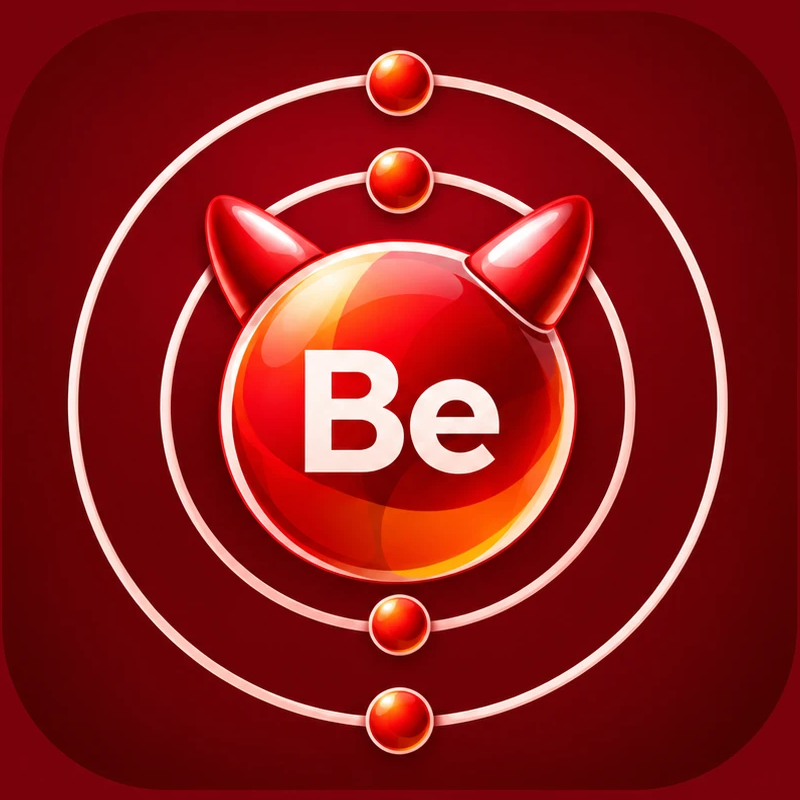

<div align="center">
    
    <h1>Beryllium</h1>
    <p>
        A FreeBSD fork of the <a href="https://github.com/imputnet/helium">Helium</a> browser.
        <br>
        Helium's privacy, FreeBSD's security model.
    </p>
</div>

## Goal

**The goal of this project is to create Beryllium: a native FreeBSD fork of
Helium.**

Beryllium builds Helium from source as a native FreeBSD application and ships
it as an ordinary `pkg` package. It keeps Helium's privacy features and
replaces the missing Chromium sandbox on FreeBSD with one built on FreeBSD's
own security primitives.

Helium is element 2. Beryllium is element 4.

## Status

> [!WARNING]
> Beryllium is in the **planning stage**. There is no FreeBSD build, no
> package, and no sandbox code yet. Nothing in this repository should be
> used as a browser on FreeBSD today.

The design is written up in [`plan/`](plan/00-INDEX.md). Start with the
[index](plan/00-INDEX.md), then the [project charter](plan/01-PROJECT-CHARTER.md)
and the [roadmap](plan/09-ROADMAP.md). The engineering specification the plan
implements is [helium-freebsd-security-port-spec.md](helium-freebsd-security-port-spec.md).

## Why Beryllium exists

Chromium already runs on FreeBSD through the `www/chromium` port, but it runs
without kernel-enforced process confinement. The port's FreeBSD sandbox code
lowers one memory limit and returns. There is no zygote, no seccomp
equivalent and no Capsicum. A compromised renderer has the same access to
files, sockets and processes as the user who started the browser.

Helium does not support FreeBSD, and its maintainers have said they do not
have the bandwidth to do so. Beryllium is an independent downstream project
that fills that gap.

## What Beryllium keeps from Helium

- Helium's patch set, defaults and build flags, including the
  ungoogled-chromium base.
- The bundled Helium fork of uBlock Origin, its filter defaults and CNAME
  uncloaking.
- Native `!bangs`, onboarding at `helium://setup`, fingerprinting noise,
  and the rest of Helium's privacy customizations.
- Helium services for extension proxying, bangs, filter lists and
  dictionaries, controlled by the same user preferences.

Two things differ because of the platform. Browser updates arrive through
`pkg`, not an in-app updater. Crash reports are not uploaded, because the
crash handler does not run on FreeBSD.

## What Beryllium adds

| Layer | Purpose |
|---|---|
| **Capsicum renderer sandbox** | Every renderer enters capability mode with an audited, rights-limited set of file descriptors. No path access, no direct network sockets, no access to other processes. Sandbox setup failure is fatal in production builds. This is the central milestone. |
| **Per-process policies** | Separate confinement for PDF, print, audio, network, GPU and media utility processes, each with its own tests or a published risk statement. |
| **Process hardening** | Tracing disabled, no privilege gain, calibrated resource limits per process type. |
| **Optional jail profile** | An administrator-managed whole-browser jail as an outer perimeter. Never a substitute for the renderer sandbox and never installed automatically. |
| **Resource profiles** | Measured `rctl` rule sets for jail deployments. |
| **MAC study** | A documented decision on whether a MAC policy addresses any remaining risk. Not required for a first release. |

Every release will publish a table stating what is enforced and tested, what
is configured but untested, and what is planned.

## Roadmap

| Phase | Outcome |
|---|---|
| 0. Baseline | Reproduce the current FreeBSD Chromium build and record what is actually sandboxed |
| 1. Native build | `www/beryllium` builds and runs on FreeBSD with Helium's behaviour preserved and no sandbox claims |
| 2. Capsicum renderer | Renderers confined in capability mode and verified by tests |
| 3. Other processes | Utility, audio, network and GPU policies |
| 4. Jail and resources | Optional jail profile and measured resource limits |
| 5. MAC study | Decision memo |
| 6. Release engineering | Signed packages, CI, and a maintenance process another person can follow |

Details, effort estimates and the first-release definition are in the
[roadmap](plan/09-ROADMAP.md).

## Targets

- FreeBSD `amd64` on the supported stable branches (currently 14.x and 15.x),
  with kernels patched for FreeBSD-SA-26:28.capsicum.
- X11 and Wayland.
- `aarch64` later, once CI covers it.

## Repository layout

Beryllium is a platform repository, the FreeBSD counterpart of Helium's own
[helium-linux](https://github.com/imputnet/helium-linux),
[helium-macos](https://github.com/imputnet/helium-macos) and
[helium-windows](https://github.com/imputnet/helium-windows). Helium is
included as a git submodule pinned at a release tag. Nothing inside it is
edited, so updating Helium never causes merge conflicts.

| Path | Contents |
|---|---|
| `helium/` | Submodule: [imputnet/helium](https://github.com/imputnet/helium) at release tag `0.19.4` (Chromium 155.0.8059.84) |
| `patches/` | Beryllium patches for FreeBSD platform, branding and security, applied after Helium's (planned) |
| `flags.freebsd.gn` | FreeBSD build flags appended to Helium's `flags.gn` (planned) |
| `freebsd/` | FreeBSD port, sandbox policies, test suites, tooling and branding |
| `plan/` | Planning documents |

Clone with the submodule:

```bash
git clone --recurse-submodules https://github.com/johnjanik/Beryllium.git
```

## Relationship to Helium

Beryllium is not affiliated with or endorsed by Helium or imput. Problems with
Beryllium should be reported here, not to the Helium project. Helium's own
README, downloads and documentation are at
[github.com/imputnet/helium](https://github.com/imputnet/helium) and
[helium.computer](https://helium.computer/).

Platform-neutral fixes that would benefit Helium may be offered upstream.
Any such contribution follows Helium's
[CONTRIBUTING.md](https://github.com/imputnet/helium/blob/main/CONTRIBUTING.md),
which requires that contributions be written by people, not generated by AI.

## Contributing

Beryllium is at the planning stage. Issues that discuss the plan are welcome.
Changes that touch process creation, IPC, file descriptors, shared memory,
the GPU process, the network service or sandbox setup require a security
review before merging.

## Credits

- **[Helium](https://github.com/imputnet/helium)** by imput, which Beryllium
  is forked from and depends on for everything that makes the browser what
  it is.
- **[The Chromium Project](https://www.chromium.org/)**, at the core of
  Helium and Beryllium.
- **[ungoogled-chromium](https://github.com/ungoogled-software/ungoogled-chromium)**,
  which Helium is based on.
- **Other Chromium browsers** whose patches Helium includes:
  [Inox patchset](https://github.com/gcarq/inox-patchset),
  [Debian](https://tracker.debian.org/pkg/chromium-browser),
  [Bromite](https://github.com/bromite/bromite),
  [Iridium Browser](https://iridiumbrowser.de/) and
  [Brave](https://github.com/brave/brave-core).
  Helium's patches are sorted by vendor in [helium/patches/](https://github.com/imputnet/helium/tree/main/patches).
- **The FreeBSD and OpenBSD Chromium ports**, maintained at
  `chromium@FreeBSD.org` and in OpenBSD ports, whose BSD patch set makes a
  FreeBSD build possible.
- **Earlier Capsicum work on Chromium**: the 2010 Capsicum paper by Watson,
  Anderson, Laurie and Kennaway, and the FreeBSD Capsicum sandbox efforts
  tracked in FreeBSD bug 269234.

## License

All code, patches, modified portions of imported code or patches, and any
other content unique to Helium or Beryllium and not imported from other
repositories is licensed under GPL-3.0. See [LICENSE](LICENSE).

Helium, included as a submodule, is under its own licenses: GPL-3.0 for
Helium's code, with imported content keeping its original license. For
example, original unmodified code imported from ungoogled-chromium remains
under its
[BSD 3-Clause license](https://github.com/imputnet/helium/blob/main/LICENSE.ungoogled_chromium).
